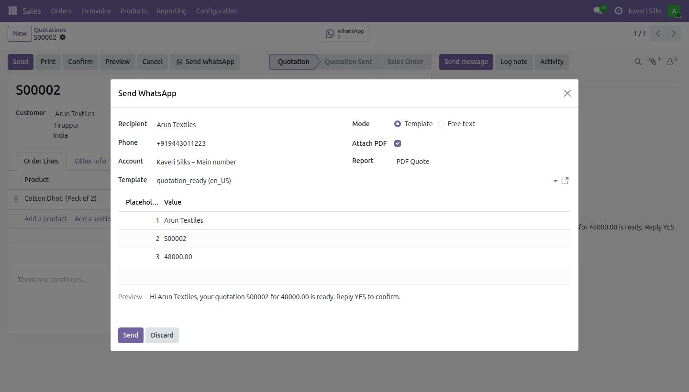
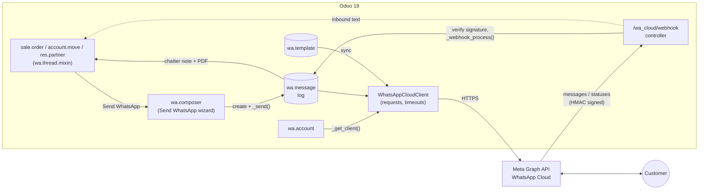
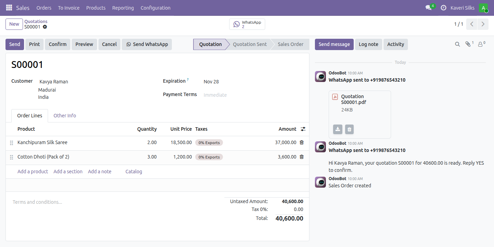
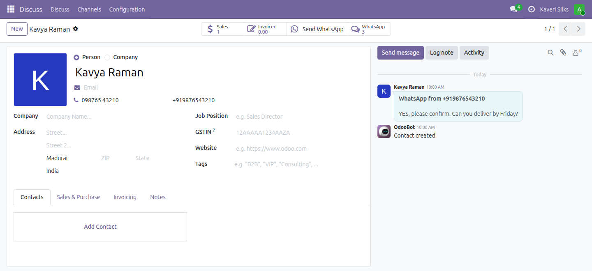
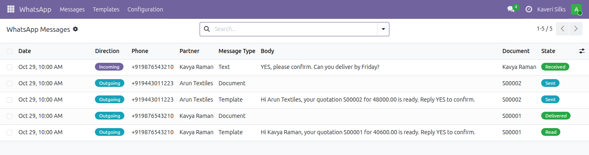
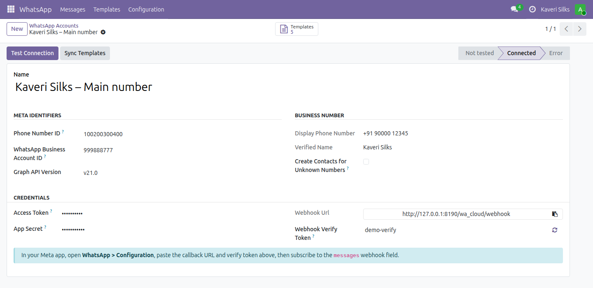
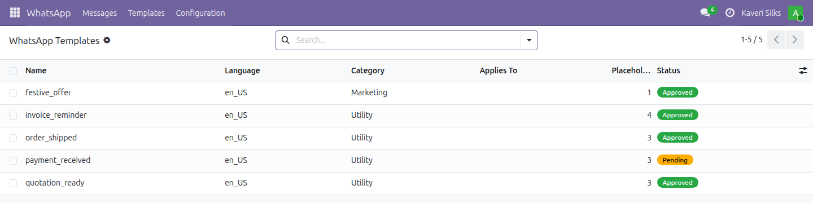

# WhatsApp Cloud API Connector for Odoo 19

> Send approved WhatsApp templates, free-text replies and PDF quotations/invoices straight from Odoo 19 Community, and get replies and delivery receipts back in the chatter, using Meta's official WhatsApp Cloud API.

[](LICENSE)
[](https://github.com/odoo/odoo/tree/19.0)
[](https://www.python.org/)
[](https://docs.astral.sh/ruff/)
[](https://github.com/Pirainuthal/odoo-whatsapp-cloud/actions/workflows/lint.yml)

Odoo's own WhatsApp app is Enterprise-only. This module (`wa_cloud_connector`) is a small, readable
LGPL alternative for Community that covers the everyday sales flow: *send the quote on WhatsApp,
see when it was read, and catch the customer's reply.*



---

## Features

| | |
|---|---|
| **Account setup** | Phone number ID, WABA ID, Graph API version. The access token, app secret and webhook verify token are only visible to *Settings* administrators (`base.group_system`). A **Test Connection** button fetches the verified business name and number. |
| **Template sync** | Pulls every message template (name, language, status, category, header/body/footer) from the Graph API, following pagination. Templates are created, updated, or archived when Meta no longer returns them. |
| **Placeholder mapping** | Map each `{{n}}` to a dotted field path (`partner_id.name`, `name`, `amount_total`...) with a fallback value. Users can still edit the values before sending. |
| **Send WhatsApp** | Button and wizard on **quotations / sales orders**, **customer invoices** and **contacts**: pick an approved template or write free text, preview the rendered message, and optionally attach the document's PDF report (uploaded to Meta as media, then sent as a document). |
| **24-hour window hint** | The wizard warns when a free-text message is outside the customer-service window (no inbound message in the last 24 h). |
| **Message log** | Every outgoing and incoming message is stored with direction, type, `wamid`, status (`queued → sent → delivered → read` / `failed` / `received`) and error. Messages are mirrored in the related record's chatter, and each document gets a WhatsApp smart button. Failed messages can be retried. |
| **Secure webhook** | `GET` subscription handshake (`hub.challenge`) and `POST` notifications verified with **HMAC-SHA256** (`X-Hub-Signature-256`) against the app secret. A payload is only applied to the accounts whose app secret signed it. Duplicate deliveries are ignored, and out-of-order status callbacks never downgrade a message (a late *delivered* after *read*, or a late *sent* after *failed*). |
| **Inbound messages** | Matched to a contact by normalised phone number and posted on that contact's chatter. Can optionally create a contact for unknown numbers from the WhatsApp profile name. |
| **Phone normalisation** | Dependency-free E.164 helper (`098765 43210` → `+919876543210`) that falls back on the contact's country, then the company's country. A stored, indexed `wa_phone` field on contacts gives fast matching. |
| **Security** | *WhatsApp / User* and *WhatsApp / Administrator* groups, ACLs and multi-company record rules. Users cannot edit the message log, and before anything is uploaded to Meta the sender's read access to the document and its attachment is checked. |

## Architecture



Design choices:

* **One network seam.** All HTTP traffic goes through `tools/graph_client.py::WhatsAppCloudClient`,
  a plain Python class with no Odoo imports. `wa.account._get_client()` is the only place that
  builds it, so tests swap in a fake client with a single patch.
* **Failures are data, not exceptions.** A failed send is logged as `failed` with Meta's error
  code and shown in the chatter. The transaction is not rolled back, so the user can see what
  happened and retry.
* **The webhook trusts nothing.** The signature is checked over the raw body before the JSON is
  parsed, and each change is applied only to an account whose own app secret signed it.
  Constant-time comparisons (`hmac.compare_digest`) are used for both the signature and the
  verify token.

```
wa_cloud_connector/
├── controllers/main.py        # webhook: GET handshake + signed POST
├── models/
│   ├── wa_account.py          # credentials, test connection, webhook dispatch
│   ├── wa_template.py         # templates, placeholder mapping, Meta sync
│   ├── wa_message.py          # log, send, inbound + status processing
│   ├── wa_thread_mixin.py     # "Send WhatsApp" + smart button for any document
│   └── res_partner.py / sale_order.py / account_move.py
├── tools/
│   ├── graph_client.py        # WhatsAppCloudClient + WhatsAppApiError
│   └── phone.py               # normalize_phone() -> E.164
├── wizard/wa_composer.py      # Send WhatsApp wizard
└── tests/                     # TransactionCase + HttpCase, fully mocked
```

## Quick start

Requirements: Odoo **19.0** Community (tested on a 19.0 source checkout), Python 3.10+, and `requests` (already an
Odoo dependency).

```bash
git clone https://github.com/Pirainuthal/odoo-whatsapp-cloud.git
# The repository root is an addons directory:
./odoo-bin -c odoo.conf \
  --addons-path=/path/to/odoo/addons,/path/to/odoo-whatsapp-cloud \
  -d mydb -i wa_cloud_connector
```

Then open **WhatsApp → Configuration → Accounts**.

## Configuration

### 1. Meta developer app (high level)

1. On [developers.facebook.com](https://developers.facebook.com/), create an app of type
   **Business** and add the **WhatsApp** product.
2. Under **WhatsApp → API Setup**, note the **Phone number ID** and the
   **WhatsApp Business Account ID**. Add a real business number when you are ready to leave the
   test number.
3. In **Business Settings → System users**, create a system user, give it the app and the WABA,
   and generate a **permanent token** with `whatsapp_business_messaging` and
   `whatsapp_business_management` permissions.
4. In **App settings → Basic**, copy the **App secret**.
5. Create and submit message templates in **WhatsApp Manager** and wait for approval.

### 2. Odoo account

| Field | Value |
|---|---|
| Phone Number ID / WhatsApp Business Account ID | from step 2 |
| Access Token | the permanent system-user token |
| App Secret | from step 4, used to verify webhook signatures |
| Webhook Verify Token | pre-filled with a random value. Copy it to Meta. |
| Create Contacts for Unknown Numbers | optional |

Click **Test Connection**, then **Sync Templates**. On a template, choose **Applies To** (for
example *Sales Order*) and map its placeholders.

### 3. Webhook

In the Meta app go to **WhatsApp → Configuration → Webhook**. Set the callback URL to the
**Webhook URL** shown on the account (`https://<your-odoo>/wa_cloud/webhook`) and paste the verify
token. Then subscribe to the **`messages`** field.

> The endpoint uses `auth="public"`, so Odoo must be able to pick the database without a session.
> Run a single database or set `dbfilter`. Meta only calls public HTTPS URLs; for local testing
> use a tunnel such as `ngrok` or `cloudflared`.

### 4. Access rights

Give users the **WhatsApp / User** group (send messages, read the log) or
**WhatsApp / Administrator** (accounts, templates, placeholder mapping). The administrator user
gets *Administrator* on install.

## Usage

**From a quotation:** open a quotation and click **Send WhatsApp**. Pick the `quote_ready`
template; its placeholders are pre-filled (`{{1}}` → customer name, `{{2}}` → order reference).
Keep **Attach PDF** ticked and click **Send**. The customer receives the template followed by the
quotation PDF. The chatter shows both messages, and the WhatsApp smart button opens the log, where
the status moves to *Delivered* and then *Read* as Meta reports back.

**Replying to a customer:** when a customer writes, the message appears on their contact's
chatter. Within 24 hours you can answer with **Free text** from the contact's **Send WhatsApp**
button.

**From code:** the client works on its own, outside Odoo:

```python
from odoo.addons.wa_cloud_connector.tools import WhatsAppCloudClient, normalize_phone

client = WhatsAppCloudClient(access_token="...", phone_number_id="1234567890")
to = normalize_phone("098765 43210", default_country_code=91).lstrip("+")
wamid = client.send_template(to, "order_ready", "en_US", ["Kavya", "S00042"])
```

Inside Odoo, prefer the logged path so the message is tracked:

```python
env["wa.message"].create(
    {
        "account_id": account.id,
        "phone": "+919876543210",
        "message_type": "text",
        "body": "Your order has shipped!",
        "res_model": order._name,
        "res_id": order.id,
    }
)._send()
```

## Screenshots

Captured from a local Odoo 19 Community database with demo data. The Graph API client was replaced
by the test suite's fake client, so no real messages were sent.

**Chatter**: the sent template and the quotation PDF are mirrored on the document.



| Customer reply in the contact's chatter | Message log with delivery status |
|---|---|
|  |  |

| Account (after *Test Connection*) | Synced templates |
|---|---|
|  |  |

## Testing

The test suite never touches the network. A `FakeWhatsAppClient` replaces the Graph API client,
and the HTTP layer is tested with a mocked `requests.Session`.

| Test module | Covers |
|---|---|
| `test_phone.py` | E.164 normalisation edge cases, contact `wa_phone`, partner matching |
| `test_graph_client.py` | request URL/headers/timeouts, payloads, Graph error parsing, pagination, media upload |
| `test_template_sync.py` | template parsing, create/update/archive sync, test connection, placeholder field paths |
| `test_send.py` | wizard defaults, template/text/PDF sends, log + chatter, failures and retry, validations, 24 h window, inbound and status processing |
| `test_security.py` | user-level send, read-only log, attachment exfiltration guard, report/model mismatch, verify-token rotation rights, cross-app signature isolation, non-ASCII tokens |
| `test_webhook.py` (`HttpCase`) | `hub.challenge` handshake, valid/invalid/tampered signatures (200/403), inbound to chatter, status callback, malformed or non-object JSON (400) |

Run them against a throw-away database:

```bash
./odoo-bin -c odoo.conf \
  --addons-path=/path/to/odoo/addons,/path/to/odoo-whatsapp-cloud \
  -d test_wa -i wa_cloud_connector \
  --test-tags /wa_cloud_connector --stop-after-init \
  --log-level=test
# ... odoo.tests.result: 0 failed, 0 error(s) of 56 tests
```

Lint and format (also run in CI):

```bash
python -m venv .venv && .venv/bin/pip install ruff
.venv/bin/ruff format --check . && .venv/bin/ruff check .
```

## Roadmap

- [ ] Header media (image/document) and button parameters for templates
- [ ] Send media from the chatter composer and download inbound media into attachments
- [ ] Queue sending through `ir.cron` for bulk / mass messaging with rate limiting
- [ ] Opt-out handling (STOP keyword → blacklist)
- [ ] Odoo test job in GitHub Actions (PostgreSQL service + Odoo 19 checkout)
- [ ] Discuss-channel style conversation view per contact

## License

[LGPL-3.0](LICENSE) © 2026 [Pirainuthal S](https://github.com/Pirainuthal)

*WhatsApp and Meta are trademarks of Meta Platforms, Inc. This is an independent open-source
project and is not affiliated with or endorsed by Meta.*
